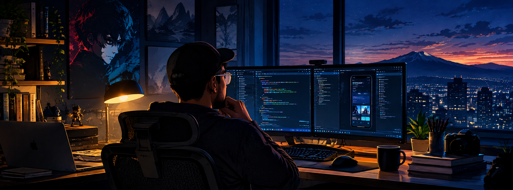
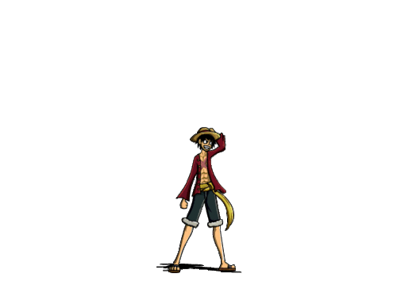
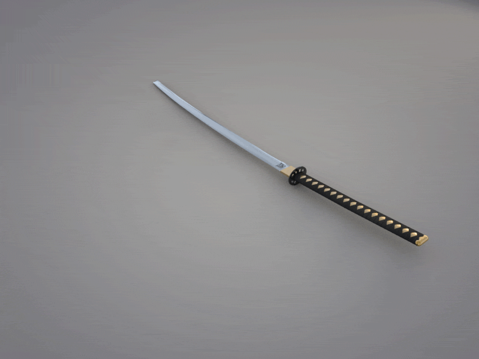

<!-- Top Panoramic Banner -->

  

 

<!-- One-Line Summary & Identity -->

  <h1>Hi, I'm Hrushikesh Desai! </h1>
  

    <strong>Software Development Engineer II (Mobile Systems)</strong> &nbsp;•&nbsp; 5+ Years Exp &nbsp;•&nbsp; Mumbai, India
  

  

  <!-- Quick Action Badges -->
  

    
    
    
    
  

 

<!-- Engineering Focus (SDE II) -->
<table>
  <tr>
    <td width="130" align="center" valign="middle">
      
    </td>
    <td valign="middle">
      

         <b>Mobile Systems & Architecture</b> 
        Engineering scalable production applications across Flutter, Android (Kotlin), and iOS (Swift) with modular Clean Architecture, BLoC, and Riverpod.
      

      

         <b>Performance & Native Core</b> 
        Low-level Dart FFI, C++, native Platform Channels, and thread/memory profiling for locked 60/120 FPS rendering.
      

      

         <b>Open Source & Tooling</b> 
        Author of <a href="https://pub.dev/packages/sdui_core"><code>sdui_core</code></a> (Server-Driven UI engine with 160/160 pub points) and on-device AI tooling.
      

    </td>
  </tr>
</table>

 

<!-- Tech Stack -->
<table>
  <tr>
    <td width="130" align="center" valign="middle">
      
    </td>
    <td valign="middle">
      
      
      
      
      
      
      
      
      
      
    </td>
  </tr>
</table>

 

<!-- Realtime GitHub Stats & Activity -->

  
  

 

<!-- Footer -->

  
    
  

    <a href="https://hrushikeshdesai.com">
       <code>hrushikeshdesai.com</code>
    </a>
    &nbsp;&nbsp;•&nbsp;&nbsp;
    <a href="https://topmate.io/hrushikeshdesai">
       <code>topmate.io/hrushikeshdesai</code>
    </a>
    &nbsp;&nbsp;•&nbsp;&nbsp;
    <a href="https://twitter.com/hrushikesh_hd">
       <code>@hrushikesh_hd</code>
    </a>
  

